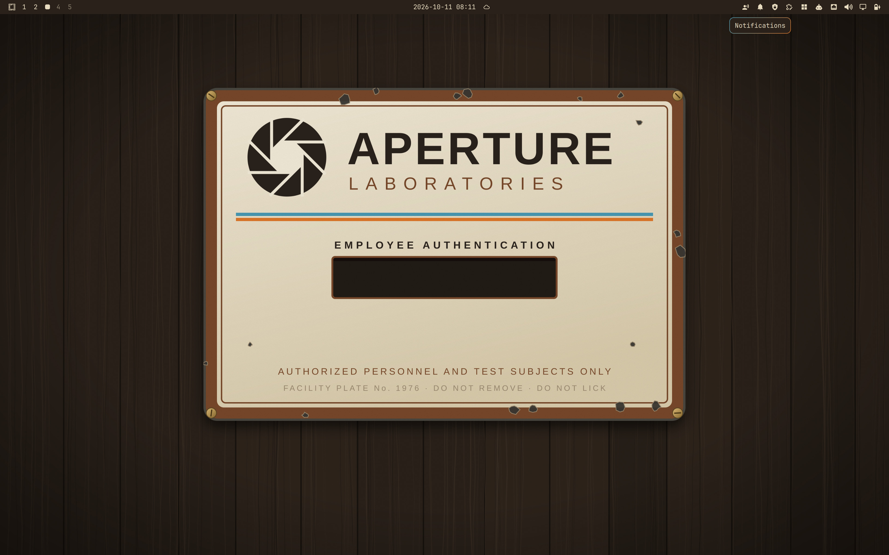

# Aperture 1976

Aperture Laboratories, gel-testing era. Walnut paneling, cream enamel, harvest
gold and avocado, with two coloured stripes on top: repulsion gel blue and
propulsion gel orange. Portals came later. In 1976 the blue and the orange were
things you poured.



## Install

```bash
omarchy theme install https://github.com/smolamSK/omarchy-aperture-1976-theme.git
```

That clones the theme into `~/.config/omarchy/themes/aperture-1976` and applies
it. Afterwards it is under *Style > Theme* as **Aperture 1976**. To update,
run the same command again.

Requires Omarchy 4 (semantic `colors.toml` keys, Quickshell `shell.toml`).

## Palette

| Role | Hex | Source |
|---|---|---|
| background | `#2a211a` | walnut paneling |
| foreground | `#e8dcc0` | cream enamel |
| accent / orange | `#e0782a` | propulsion gel, faded |
| blue | `#4a9bb5` | repulsion gel, faded |
| yellow | `#d4a13a` | harvest gold (selection fill in the shell) |
| green | `#8a9a3b` | avocado |
| red | `#dd6a50` | brick |
| cyan | `#4fa39d` | 70s teal |
| magenta | `#bf7f93` | dusty plum |
| brown | `#7a4a2a` | enamel border band |

Every ANSI colour clears 4.5:1 against the background.

The active window border is the gel gradient, `rgba(4a9bb5ee) rgba(e0782aee) 45deg`.

## Files

- `colors.toml`: the palette. Omarchy generates terminals, btop, Neovim
  (aether.nvim), VS Code, helix and the rest from it.
- `shell.toml`: Omarchy's shell template rendered with this palette, then
  hand-tuned. Opaque walnut cards, orange for anything asking for attention,
  harvest-gold selection, gel-gradient borders.
- `backgrounds/`: three original wallpapers, generated from
  `backgrounds-src/make.py`. Run `backgrounds-src/render.sh` to regenerate
  them (needs `rsvg-convert` and `magick`).
  1. **Enamel plate**: the default. A chipped facility sign with a blank
     "Employee Authentication" field at the exact centre of the screen, where
     the lock screen's password card appears. The lock blurs the wallpaper
     heavily, so on the lock screen the plate reads as a cream glow behind the
     card.
  2. **Gel blueprint**: chamber 07 cross section, gel delivery.
  3. **Brochure**: 1976 employee orientation, with racing stripes.
- `keyboard.rgb`: propulsion orange.

## GLaDOS (optional)

`hooks/aperture-1976-glados` sends a notification with one of eight original
lines whenever this theme is applied, and does nothing for any other theme.
Omarchy never installs hooks from a theme, so opt in yourself:

```bash
omarchy hook install theme-set ~/.config/omarchy/themes/aperture-1976/hooks/aperture-1976-glados
```

With the [GLaDOS Voice](https://github.com/smolamSK/omarchy-glados-voice)
plugin installed, she reads the line aloud. Without it, it is just a
notification.

## License

MIT, covering the code, the wallpaper generator and the rendered wallpapers.
See [LICENSE](LICENSE).

This is fan work and is not affiliated with or endorsed by Valve. Aperture
Laboratories, Aperture Science and Portal are Valve's. All artwork here is
drawn from scratch, and every GLaDOS line is original.
